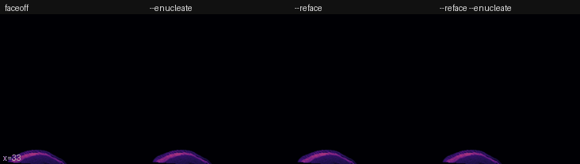

# FaceOff [](https://github.com/srikash/FaceOff/releases/tag/v1.9.5) [](LICENSE) [](https://zenodo.org/badge/latestdoi/307797054)

Deface anatomical MRI scans with ANTs. FaceOff removes the face, and the eyes if you ask, and can put the template's face and eyes back.

- Reorients to template orientation and crops in the same run, with no interpolation.
- `--extra-images` (MP2RAGE, GRE echoes) and `--batch` (many scans).
- A QC page with every run.
- ANTs from your PATH, Docker, or Apptainer.

<p align="center">
  
  <br>
  <em>Face/Off (1997)</em>
</p>

## Install

You need Python 3.12 or newer, and ANTs 2.6 on your PATH, Docker, or Apptainer (or Singularity).

```bash
pip install faceoff
faceoff --help
```

Conda, clusters, and Apptainer: [docs/installation.md](docs/installation.md).

## Quick start

```bash
faceoff -i sub-01_T1w.nii.gz                    # deface and reorient
faceoff -i sub-01_T1w.nii.gz --reface           # also put a face back
faceoff -i sub-01_T1w.nii.gz --enucleate        # remove the eyes too
faceoff -i sub-01_T1w.nii.gz --renucleate       # remove the eyes and put template eyes back
faceoff --batch sub-*_T1w.nii.gz                # several scans, one after another
faceoff -i sub-01_UNIT1.nii.gz --extra-images sub-01_inv-*_MP2RAGE.nii.gz   # MP2RAGE or GRE echoes
```

Outputs go next to the input: [docs/outputs.md](docs/outputs.md).

## Example outputs



The template's face and eyes are shown in turbo.

## How it compares

FaceOff, [pydeface](https://github.com/poldracklab/pydeface) 2.1.0, and AFNI's `afni_refacer2` on the same 1 mm MPRAGE, 12 cores:

| | **FaceOff** | pydeface | afni_refacer2 |
| --- | --- | --- | --- |
| Deface | **12 s** | 2 min 35 s | 2 min 54 s |
| Reface | **56 s** | not available | 2 min 59 s |
| Remove the eyes | **47 s** (`--enucleate`)<br>**59 s** with `--reface` | not available | not available |

- Median of 3 runs. FaceOff's reorientation to template orientation comes for free, with no interpolation.
- [Results](docs/results.md): the three tools' outputs side by side.

**Planned:** an option to use AFNI's refacer template and shell in place of FaceOff's own template.

## More

[Installation](docs/installation.md) · [Usage](docs/usage.md) · [Outputs](docs/outputs.md) · [Results](docs/results.md) · [Template](docs/template.md) · [Development](docs/development.md) · [Citation](docs/citation.md)

## Licence and citation

MIT licence; the template files keep the [MNI licence](faceoff/COPYING-MNI). If you use FaceOff, please cite it, the MNI ICBM152 template, and ANTs: [docs/citation.md](docs/citation.md).
