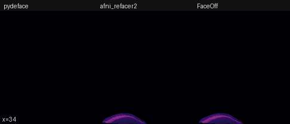
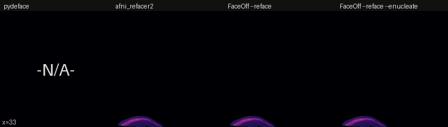

# Results

pydeface, afni_refacer2, and FaceOff run on the same scan: one 1 mm MPRAGE (256 x 256 x 256 voxels, 16-bit integers) on a 12-core workstation. The images are sagittal sweeps at 5 frames per second, the same as FaceOff's QC page, drawn in the same colours (magma for the scan, turbo for what was put in place of the face). They show the defaced and refaced results only, never the original scan.

Versions: pydeface 2.1.0 (FSL FLIRT), AFNI 26.3.04 with `afni_refacer2` 2.7, and FaceOff 2.0.0 with ANTs 2.6.5.dev1 on the local machine.

## Defaced



| | pydeface | afni_refacer2 | FaceOff | FaceOff `--enucleate` |
| --- | --- | --- | --- | --- |
| Head tissue removed | 528 ml | 1,364 ml | 734 ml | 744 ml |
| Brain voxels removed | 0 | 0 | 0 | 0 |
| Kept voxels changed by more than 0.5 | 35,468 | 0 | 0 | 0 |
| Output stored with a scale factor | yes | no | no | no |
| Eye region removed | 21% | 40% | 68% | 100% |
| Time | 2 min 35 s | 2 min 54 s | 12 s | 47 s |

How the rows were measured:

- Head tissue is every voxel above 12% of the scan's 99.5th percentile intensity, in the largest connected piece with its holes filled. It leaves out the background noise, which is not zero in this scan and would otherwise count as removed.
- The brain is the SynthStrip mask (`mri_synthstrip`, 1,642 ml). None of the three tools removed any of it.
- Kept voxels changed counts voxels left in the image whose value differs from the input by more than 0.5. FaceOff and afni_refacer2 leave every kept voxel exactly as it was. pydeface writes 16-bit integers with a scale factor (0.0136), which moves almost every value by less than 0.01, and it changes 35,468 voxels along the edge of its mask by up to 660.
- The eye region is FaceOff's template eye mask, moved onto the scan by FaceOff's nonlinear registration over the face, so this row favours FaceOff. By default FaceOff removes the part of the eyes that lies inside its face mask; `--enucleate` removes all of them.

How much of the head each tool removed, compared as overlap (Dice) of the removed head tissue: FaceOff and afni_refacer2 0.62, FaceOff and pydeface 0.44, pydeface and afni_refacer2 0.51.

## Refaced



pydeface does not reface, so its panel is a black box marked -N/A-. afni_refacer2 fills its shell with a smoothed generic face. FaceOff fills the removed region with the template face, scaled to the brightness of the scan; with `--enucleate` the template eyes go back too.

| | pydeface | afni_refacer2 | FaceOff `--reface` | FaceOff `--reface --enucleate` |
| --- | --- | --- | --- | --- |
| Time | N/A | 2 min 59 s | 56 s | 59 s |

afni_refacer2 takes about as long to reface as to deface: both spend almost all their time on the same affine registration (`3dAllineate`, about 2 min 16 s). FaceOff adds a nonlinear registration over the face (MI), which takes about 30 seconds.

## What these results do and do not show

This is one scan from one person. The numbers describe what each tool removed and how it treated the rest of the image. They say nothing about how hard it would be to identify someone from what remains. Two of the yardsticks (the eye region and the shape of the template face) come from FaceOff, so they cannot be used to rank the tools. The times are the median of 3 runs, and for all three tools the registration is most of the time.

## Commands

```bash
pydeface scan.nii.gz --outfile scan_defaced.nii.gz
afni_refacer2 -input scan.nii.gz -mode_deface -prefix scan_afni -no_images   # and -mode_reface
faceoff -i scan.nii.gz --engine local -n 12                                   # also --enucleate, --reface
```

`OMP_NUM_THREADS` was set to 12 for AFNI. pydeface's FLIRT uses one thread. The AFNI step times come from its own log, and the FaceOff step times from the log that `faceoff` prints.

[Back to the README](../README.md)
